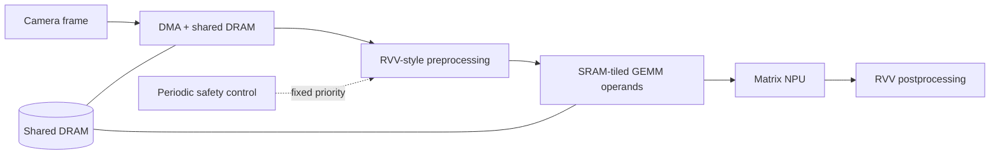
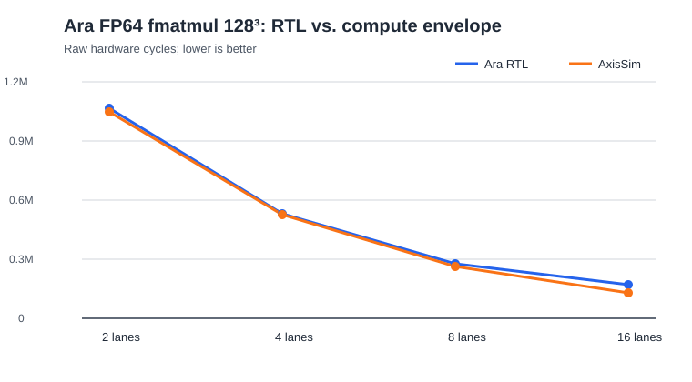
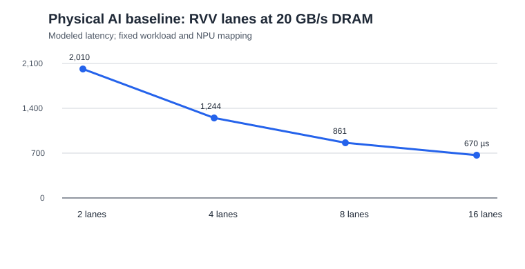
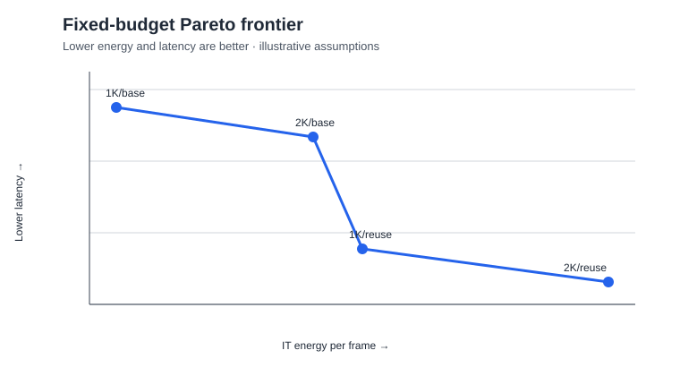

# AxisSim

AxisSim is a C++ tool for exploring how AI hardware and software choices affect speed, deadline behavior, and energy use before a chip is built. It models a hypothetical real-time vision system and helps answer practical design questions: Should we add more compute, improve memory bandwidth, change the workload mapping, or adjust scheduling?

### At a glance

- Models an end-to-end AI vision pipeline, from data movement and image processing through neural-network inference.
- Compares compute, memory, scheduling, and energy tradeoffs with reproducible experiments.
- Identifies bottlenecks such as memory saturation and missed real-time deadlines.
- Includes automated tests, machine-readable results, and an optional desktop interface for interactive exploration.

## Technical overview

AxisSim is a configurable, deterministic simulator for a **hypothetical Physical AI SoC**. It estimates latency, deadline reliability, shared-DRAM traffic, and energy for a camera-to-inference pipeline comprising DMA, an RVV-style vector engine, and a tiled GEMM NPU.

The project is an independent architecture-exploration tool. Its arithmetic-energy scale is a hypothetical parameter inspired by public discussion of lower-power arithmetic; it does not model or disclose any proprietary implementation.



## Capabilities

- Layered, validated `key = value` configuration manifests
- Unified discrete-event runtime for normal and control-enabled workloads
- Shared DRAM/DMA contention and explicit task dependencies
- RVV-style strip-mined kernels with configurable VLEN, SEW, LMUL, lanes, setup overhead, and tail utilization
- Output-stationary tiled GEMM with SRAM-fit validation and explicit tensor traffic
- Per-operation and per-byte energy accounting
- Static-capacity power, PUE, fixed-budget feasibility, and deployment electricity-cost extrapolation
- Optional, assumption-driven area, first-order thermal, and FIT reliability proxies
- Mean/P99 latency, deadline misses, engine utilization, pipeline concurrency, traffic, energy/frame, and CSV traces
- CTest smoke coverage for valid and invalid configurations
- Reference-data calibration reports with public/reproduced provenance labels

## What the baseline study finds

All figures below are reproducible model outputs from `configs/baseline/manifest.conf`, not silicon measurements.

| Experiment | Result | Architectural implication |
|---|---:|---|
| 256 → 4,096 NPU MACs | 959.36 → 836.48 µs latency (12.8% lower) | Additional NPU throughput has diminishing returns. |
| 2 → 32 RVV lanes | 2,010.36 → 573.74 µs latency (71.5% lower) | Vector preprocessing is a more valuable performance investment for this mapping. |
| 3× lower NPU arithmetic energy | 107.76 → 103.28 µJ/frame (3.9% lower) | DRAM dominates modeled energy; arithmetic gains need system-level context. |
| DRAM below 0.5 GB/s | 30/30 vision deadlines miss at 0.15 GB/s | Memory service is insufficient to sustain the configured frame stream. |

Reproduce the complete data set with:

```sh
./experiments/run_initial_study.sh
```

Read the [baseline results report](docs/results.md) for the experiment data, interpretations, and figure-generation commands.

## Ara RTL validation: where the vector model holds—and where it does not

AxisSim's `rvv_stream` mode was checked against public Verilator RTL simulations of the open-source [Ara vector processor](https://github.com/pulp-platform/ara), pinned to revision `34bd3bc152421b4601a7bf3d6e8e91ffb545c99e`. This is a **compute-envelope validation**, not a claim about silicon frequency, power, cache behavior, or a complete SoC.

The 4-lane size controls establish the model's compute-scaling slope. The 2-, 8-, and 16-lane rows are held-out configurations: the model parameters were not retuned after seeing them.

| Ara lanes | VLEN | Ara RTL cycles | AxisSim cycles | Relative difference |
|---:|---:|---:|---:|---:|
| 2 | 2,048 | 1,064,052 | 1,048,576 | 1.454% |
| 4 | 4,096 | 532,392 | 524,288 | 1.522% |
| 8 | 8,192 | 275,911 | 262,144 | 4.990% |
| 16 | 16,384 | 172,252 | 131,072 | 23.907% |



The outcome is useful precisely because it is mixed: the simple lane-throughput model follows low-to-medium parallelism well, while its error grows at 16 lanes. That exposes unmodeled fixed and scaling overhead rather than supporting an overbroad accuracy claim. See the [Ara validation report](docs/ara-validation.md), raw reproduction logs, hashes, and commands in [`reference_data/ara/reproductions`](reference_data/ara/reproductions/).

## Design-space takeaway

The checked-in 96-point Physical AI study holds the workload mapping fixed while sweeping RVV lanes, DRAM bandwidth, SRAM capacity, and NPU arithmetic-energy scale. The fastest feasible point is 16 RVV lanes and 20 GB/s DRAM at 669.51 microseconds/frame. The lower arithmetic-energy scenario reduces modeled energy from 107.76 to 103.28 microjoules/frame without changing latency.



The architectural recommendation is deliberately bounded: for this mapping, prioritize vector and memory resources before additional NPU arithmetic. SRAM capacity alone does not improve this particular fixed-tile sweep, which is a reminder that capacity only helps when the software mapping can use it. Reproduce or modify the study with [`experiments/run_design_space.sh`](experiments/run_design_space.sh).

## Arithmetic efficiency to capacity study

AxisSim also evaluates an explicitly hypothetical iso-performance arithmetic-energy scenario: the workload, resource counts, mapping, frequency, and latency model remain fixed while NPU arithmetic energy changes. It then evaluates separate reinvestment choices under a modeled IT power budget.

```sh
./experiments/run_power_budget_study.sh
./experiments/analyze_power_budget_study.sh
./experiments/run_gemm_heavy_power_study.sh
```

The default illustrative study assumes 0.1 W static IT power, a 1 W IT budget, and PUE 1.5. It finds that lower arithmetic energy plus more NPU MACs is the lowest-latency feasible point at 20 GB/s DRAM, but the same compute reinvestment becomes severely memory-bound at 0.5 GB/s DRAM (12,633.58 microseconds). The GEMM-heavy companion study shows the complementary case: arithmetic-energy reductions have a larger modeled effect when arithmetic is a greater share of workload energy.

AxisSim models the system-level consequences of an assumed arithmetic-efficiency improvement. It does not model low-voltage cells, frequency recovery, timing closure, soft-error mechanisms, yield, Titan Core IP, or Velaura silicon. Its optional area, first-order thermal, and FIT calculations are transparent sensitivity proxies—not physical-design, thermal, or reliability signoff.

### Fixed-budget Pareto result

```sh
./experiments/run_capacity_sweep.sh
./experiments/analyze_capacity_sweep.sh
```

| Illustrative assumption | Value |
|---|---:|
| Base static power | 0.05 W |
| NPU capacity power | 0.00003 W/MAC |
| RVV capacity power | 0.002 W/lane |
| SRAM capacity power | 0.0001 W/KiB |
| DRAM-interface power | 0.02 W |
| IT power budget | 0.23 W |
| PUE | 1.5 |



The 36-point sweep finds four feasible non-dominated designs. The minimum-energy point retains 1,024 MACs and the baseline tile at 861.06 microseconds. The minimum-latency point uses 2,048 MACs and a 512 KiB SRAM with a larger reuse tile, reaching 766.03 microseconds. The 4,096-MAC option is not the recommendation: once capacity power and mapping are included, a balanced compute-plus-reuse design provides better realized performance under the budget. These are modeled scenario results, not chip measurements.

## Build and run

```sh
cmake -S . -B build
cmake --build build
./build/axissim validate configs/baseline/manifest.conf
./build/axissim run configs/baseline/manifest.conf --trace frame_trace.csv
./build/axissim run configs/baseline/manifest.conf --json result.json
ctest --test-dir build --output-on-failure
```

GitHub Actions runs the same configure, build, and CTest workflow on every push and pull request; see [CI workflow](.github/workflows/ci.yml).

## Desktop explorer

When Qt 6 Widgets is available, CMake also builds `axissim-gui`, a native desktop front end for opening/editing/saving scenario manifests, launching the same CLI model, and viewing the first-frame task timeline, RVV lane sweeps, power-budget results, deployment electricity estimates, and bounded implementation proxies.

```sh
cmake -S . -B build -DAXISSIM_BUILD_GUI=ON
cmake --build build
# macOS
open build/AxisSim.app

# Linux / Windows build-tree executable
./build/axissim-gui
```

The UI calls the same CLI executable and reads its JSON/trace artifacts, so it does not have a separate performance model. Its preset menu includes the baseline, fixed-power, and explicitly illustrative deployment/proxy scenarios. The macOS bundle includes the CLI, scenario manifests, and public reference data. Save edited manifests before running; included config paths remain relative to the manifest's saved directory. The Qt target is optional (`-DAXISSIM_BUILD_GUI=OFF`) for headless CI and minimal CLI builds.

The desktop interface provides guided run-only overrides, dashboard KPIs, energy composition and lane-scaling charts, task timelines, deployment and implementation-proxy views, progress/error feedback, keyboard shortcuts, and JSON export.

To create a relocatable macOS app and DMG with Qt frameworks bundled and an ad-hoc local signature:

```sh
./scripts/package_macos.sh
```

Release artifacts are written to `build-release/AxisSim.app` and `build-release/AxisSim.dmg` by default. The bundle is ad-hoc signed for local distribution; public distribution without Gatekeeper warnings requires an Apple Developer ID signature and notarization.

For a non-interactive GUI initialization check on a machine with Qt, run:

```sh
# macOS build-tree bundle
QT_QPA_PLATFORM=offscreen ./build/AxisSim.app/Contents/MacOS/AxisSim --smoke-test
QT_QPA_PLATFORM=offscreen ./build/AxisSim.app/Contents/MacOS/AxisSim --smoke-test-run

# Linux build-tree executable
QT_QPA_PLATFORM=offscreen ./build/axissim-gui --smoke-test-run
```

The second check exercises the complete GUI-to-CLI-to-JSON/trace result path.

## Configuration layers

The baseline scenario is a manifest rather than one monolithic parameter file:

| Layer | Owns |
|---|---|
| `workload.conf` | Frame stream, vector kernels, GEMM shape, task deadlines |
| `architecture.conf` | RVV capacity, NPU MACs, tile shape, SRAM capacity |
| `implementation.conf` | Frequencies, DMA setup, DRAM bandwidth, timing overhead |
| `energy.conf` | Activity-energy assumptions and arithmetic-energy scale |

`manifest.conf` composes the layers and identifies the scenario/model version. This makes architectural facts distinct from timing and energy assumptions.

`--json result.json` emits a schema-versioned machine-readable result artifact containing scenario provenance, latency, deadline, traffic, energy, power, deployment, and proxy metrics. See [implementation proxy scope and equations](docs/implementation-proxies.md).

## First experiments

The `--set key=value` option overrides one configuration field without modifying the baseline file. For example, these runs compare a memory-constrained pipeline and a hypothetical 3x NPU arithmetic-energy improvement:

```sh
./build/axissim run configs/baseline/manifest.conf --set dram_bandwidth_gbps=0.15
./build/axissim run configs/baseline/manifest.conf --set npu_arithmetic_energy_scale=0.333333

# A larger output-stationary tile needs more SRAM but reduces refetch traffic.
./build/axissim run configs/baseline/manifest.conf \
  --set sram_capacity_bytes=262144 \
  --set npu_tile_m=128 --set npu_tile_n=128 --set npu_tile_k=128

# Increase input rate to observe cross-frame pipeline overlap and saturation.
./build/axissim run configs/baseline/manifest.conf \
  --set frames=10 --set frame_period_us=500 --set deadline_us=500
```

## Parameter sweeps

Generate a CSV for a reproducible architecture experiment:

```sh
./build/axissim sweep configs/baseline/manifest.conf \
  --sweep dram_bandwidth_gbps=0.15,0.5,1,5,20 \
  --csv experiments/bandwidth_sweep.csv
```

`sweep` accepts any supported configuration key. Use `--set` for constants shared by every point—for example, sweep `npu_macs` while holding a larger SRAM/tile mapping fixed.

Each result also includes a vector/NPU-arithmetic/DRAM/DMA energy breakdown. The NPU arithmetic scale is deliberately an independent hypothetical input, not a claim about a particular technology or full-system power reduction.

## RVV calibration workflow

`calibrate` compares a traceable reference CSV with the selected model. For `rvv_stream` references that preserve raw RTL cycles, cycles are primary; normalized latency is secondary. It reports predicted/reference values and absolute/relative error for every point:

```sh
./build/axissim calibrate configs/baseline/manifest.conf \
  --reference reference_data/ara/ara_latency_template.csv \
  --csv experiments/ara_calibration.csv
```

The checked-in CSV is deliberately an empty template: no value is treated as Ara data until it has a source URL, source revision/date, workload mapping, and either `published` or `reproduced` status. The test fixture in `tests/reference/` exercises the command but is synthetic and is not calibration evidence. See [the Ara reference-data contract](reference_data/ara/README.md).

AxisSim includes one public Ara2 reference point in `reference_data/ara/ara2_published_latency.csv`. It is a compute-only normalization of the paper's 4-lane, 1.35 GHz, 256×256 `fmatmul64` result: latency is derived from its published 10.7 GOPS throughput. The matching `rvv_stream` profile excludes CVA6 dispatch, cache behavior, Ara's VLSU, and all Physical-AI pipeline stages. Its close roofline estimate demonstrates arithmetic-rate consistency only—it is **not** a claim of end-to-end Ara accuracy or a calibrated power model.

## Fixed-priority control runtime

Set all three control parameters to enable a periodic control workload. The unified non-preemptive runtime supports `fcfs`, `fixed_priority` (the default), and `edf` policies. Under fixed priority, `safety_control` takes precedence over normal RVV pipeline work at each scheduling point.

```sh
./build/axissim run configs/baseline/manifest.conf \
  --set control_period_us=1000 \
  --set control_deadline_us=250 \
  --set control_ops=400
```

Compare policies by adding, for example, `--set scheduler_policy=edf`.

In the included stressed-control experiment, fixed priority improves control deadline misses relative to FCFS, while EDF does not; long non-preemptive RVV operations still block urgent work. This distinguishes policy selection from the need for bounded execution chunks or preemption.

Set `rvv_chunk_elements` to split vector stages into independently scheduled work units. In the stressed configuration below, 20,000-element chunks reduce fixed-priority control misses from 45/50 to 0/50, at the cost of greater vision latency and additional runtime overhead:

```sh
./build/axissim run configs/baseline/manifest.conf \
  --set frames=20 --set frame_period_us=500 --set deadline_us=500 \
  --set control_period_us=200 --set control_deadline_us=80 --set control_ops=200000 \
  --set rvv_chunk_elements=20000
```

This models deadline-sensitive resource contention; it is not a functional-safety certification model.

## Weight residency and frame buffering

The baseline reloads tiled NPU weights from DRAM for each frame and permits two frames to overlap. To model a dedicated persistent weight store, enable residency only when it can hold the complete weight tensor:

```sh
./build/axissim run configs/baseline/manifest.conf \
  --set npu_weights_resident=1 \
  --set weight_sram_capacity_bytes=262144
```

For this baseline, the model predicts 2.36 MB NPU traffic per first/steady-state frame without weight residency, versus 1.57/1.31 MB with it. `dma_double_buffering=0` serializes frame execution; the default `1` permits frame N+1 ingest to overlap work on frame N.

See [experiments/README.md](experiments/README.md) for the questions each study answers and how to generate charts.

The arithmetic-energy scenario changes NPU arithmetic energy only; it intentionally does not claim the same scaling for DRAM, DMA, SRAM, or full-system energy.

At `0.15 GB/s`, the baseline workload requires more DRAM service per frame than a 33 ms frame period allows. The resulting queue growth and deadline failures make it a useful deliberately memory-bound regression case.

## Model boundaries

This is a timing-aware architectural model, not a cycle-accurate RTL model or a functional RISC-V instruction-set simulator. Values in a configuration file are explicitly assumptions. Energy results are modeled estimates, not measured silicon power.

`(rvv_vlen_bits / rvv_sew_bits) * rvv_lmul` determines VLMAX. The vector model accounts for lane-limited execution, per-strip-mined-iteration overhead, and a partial final iteration. It remains a timing model, rather than a functional instruction-set simulator.

## Future work

- Calibrate timing and energy parameters against target-independent microbenchmarks, traces, or an external architecture model.
- Replace the single serialized DRAM model with channels, interconnect contention, and QoS behavior.
- Model multi-layer weight residency, eviction, SRAM banks, and capacity sharing.
- Explore preemptive execution and runtime overheads beyond bounded non-preemptive RVV chunks.
- Continue modularizing configuration parsing, engine models, runtime scheduling, metrics, and CLI code.
