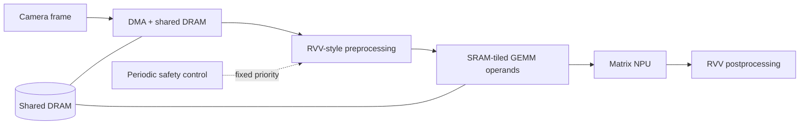

# AxisSim

AxisSim is a configurable, deterministic simulator for a **hypothetical Physical AI SoC**. It estimates latency, deadline reliability, shared-DRAM traffic, and energy for a camera-to-inference pipeline comprising DMA, an RVV-style vector engine, and a tiled GEMM NPU.

The project is an independent architecture-exploration tool. Its arithmetic-energy scale is a hypothetical parameter inspired by public discussion of lower-power arithmetic; it does not model or disclose any proprietary implementation.



## Capabilities

- Layered, validated `key = value` configuration manifests
- Unified discrete-event runtime for normal and control-enabled workloads
- Shared DRAM/DMA contention and explicit task dependencies
- RVV-style strip-mined kernels with configurable VLEN, SEW, LMUL, lanes, setup overhead, and tail utilization
- Output-stationary tiled GEMM with SRAM-fit validation and explicit tensor traffic
- Per-operation and per-byte energy accounting
- Mean/P99 latency, deadline misses, engine utilization, pipeline concurrency, traffic, energy/frame, and CSV traces
- CTest smoke coverage for valid and invalid configurations

## What the baseline study finds

All figures below are reproducible model outputs from `configs/baseline/manifest.conf`, not silicon measurements.

| Experiment | Result | Architectural implication |
|---|---:|---|
| 256 → 4,096 NPU MACs | 959.36 → 836.48 µs latency (12.8% lower) | Additional NPU throughput has diminishing returns. |
| 2 → 32 RVV lanes | 2,010.36 → 573.74 µs latency (71.5% lower) | Vector preprocessing is a more valuable performance investment for this mapping. |
| 3× lower NPU arithmetic energy | 107.76 → 103.28 µJ/frame (3.9% lower) | DRAM dominates modeled energy; arithmetic gains need system-level context. |
| DRAM below 0.5 GB/s | 30/30 vision deadlines miss at 0.15 GB/s | Memory service is insufficient to sustain the configured frame stream. |

Reproduce the complete data set with:

```sh
./experiments/run_initial_study.sh
```

## Build and run

```sh
cmake -S . -B build
cmake --build build
./build/axissim validate configs/baseline/manifest.conf
./build/axissim run configs/baseline/manifest.conf --trace frame_trace.csv
ctest --test-dir build --output-on-failure
```

GitHub Actions runs the same configure, build, and CTest workflow on every push and pull request; see [CI workflow](.github/workflows/ci.yml).

## Configuration layers

The baseline scenario is a manifest rather than one monolithic parameter file:

| Layer | Owns |
|---|---|
| `workload.conf` | Frame stream, vector kernels, GEMM shape, task deadlines |
| `architecture.conf` | RVV capacity, NPU MACs, tile shape, SRAM capacity |
| `implementation.conf` | Frequencies, DMA setup, DRAM bandwidth, timing overhead |
| `energy.conf` | Activity-energy assumptions and arithmetic-energy scale |

`manifest.conf` composes the layers and identifies the scenario/model version. This makes architectural facts distinct from timing and energy assumptions.

## First experiments

The `--set key=value` option overrides one configuration field without modifying the baseline file. For example, these runs compare a memory-constrained pipeline and a hypothetical 3x NPU arithmetic-energy improvement:

```sh
./build/axissim run configs/baseline/manifest.conf --set dram_bandwidth_gbps=0.15
./build/axissim run configs/baseline/manifest.conf --set npu_arithmetic_energy_scale=0.333333

# A larger output-stationary tile needs more SRAM but reduces refetch traffic.
./build/axissim run configs/baseline/manifest.conf \
  --set sram_capacity_bytes=262144 \
  --set npu_tile_m=128 --set npu_tile_n=128 --set npu_tile_k=128

# Increase input rate to observe cross-frame pipeline overlap and saturation.
./build/axissim run configs/baseline/manifest.conf \
  --set frames=10 --set frame_period_us=500 --set deadline_us=500
```

## Parameter sweeps

Generate a CSV for a reproducible architecture experiment:

```sh
./build/axissim sweep configs/baseline/manifest.conf \
  --sweep dram_bandwidth_gbps=0.15,0.5,1,5,20 \
  --csv experiments/bandwidth_sweep.csv
```

`sweep` accepts any supported configuration key. Use `--set` for constants shared by every point—for example, sweep `npu_macs` while holding a larger SRAM/tile mapping fixed.

Each result also includes a vector/NPU-arithmetic/DRAM/DMA energy breakdown. The NPU arithmetic scale is deliberately an independent hypothetical input, not a claim about a particular technology or full-system power reduction.

## Fixed-priority control runtime

Set all three control parameters to enable a periodic, high-priority control workload. The runtime dispatches ready tasks non-preemptively, giving `safety_control` precedence over normal RVV pipeline work at each scheduling point.

```sh
./build/axissim run configs/baseline/manifest.conf \
  --set control_period_us=1000 \
  --set control_deadline_us=250 \
  --set control_ops=400
```

This models deadline-sensitive resource contention; it is not a functional-safety certification model.

## Weight residency and frame buffering

The baseline reloads tiled NPU weights from DRAM for each frame and permits two frames to overlap. To model a dedicated persistent weight store, enable residency only when it can hold the complete weight tensor:

```sh
./build/axissim run configs/baseline/manifest.conf \
  --set npu_weights_resident=1 \
  --set weight_sram_capacity_bytes=262144
```

For this baseline, the model predicts 2.36 MB NPU traffic per first/steady-state frame without weight residency, versus 1.57/1.31 MB with it. `dma_double_buffering=0` serializes frame execution; the default `1` permits frame N+1 ingest to overlap work on frame N.

See [experiments/README.md](experiments/README.md) for the questions each study answers and how to generate charts.

The arithmetic-energy scenario changes NPU arithmetic energy only; it intentionally does not claim the same scaling for DRAM, DMA, SRAM, or full-system energy.

At `0.15 GB/s`, the baseline workload requires more DRAM service per frame than a 33 ms frame period allows. The resulting queue growth and deadline failures make it a useful deliberately memory-bound regression case.

## Model boundaries

This is a timing-aware architectural model, not a cycle-accurate RTL model or a functional RISC-V instruction-set simulator. Values in a configuration file are explicitly assumptions. Energy results are modeled estimates, not measured silicon power.

`(rvv_vlen_bits / rvv_sew_bits) * rvv_lmul` determines VLMAX. The vector model accounts for lane-limited execution, per-strip-mined-iteration overhead, and a partial final iteration. It remains a timing model, rather than a functional instruction-set simulator.
